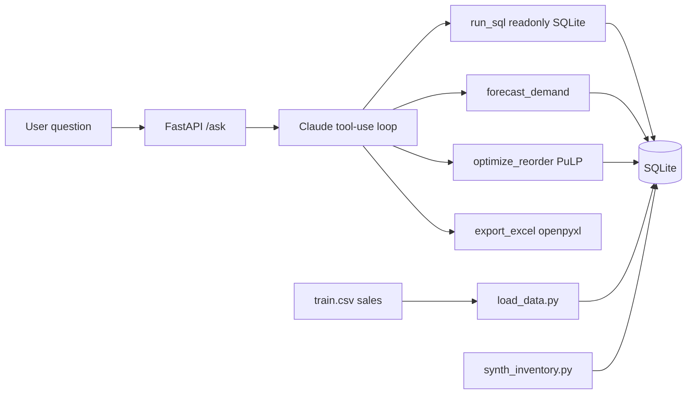

# Supply Chain Ops Copilot

**Status: in progress** — core MVP code is in place; full agent evals are not marked passing until you run them with a real DB + `ANTHROPIC_API_KEY`.

Plain-English supply chain questions → Claude API agent (tool use) → SQLite queries, demand forecast, budget-constrained reorder optimization, Excel export.

MVP surface: **FastAPI endpoints only** (no UI).

## Data story (read this)

- **Sales:** from the [Kaggle Store Item Demand Forecasting Challenge](https://www.kaggle.com/c/demand-forecasting-kernels-only) (`train.csv`) when you download it.
- **Inventory, suppliers, unit cost, lead time, on-hand:** **synthetic**, generated with a fixed random seed. They are layered on top of real sales so we can demo planning workflows.
- Never claim inventory or supplier data is real.

CI and unit tests use `tests/fixtures/sample_train.csv` only (a few stores/items/days). That fixture is **not** the Kaggle dataset.

## Architecture



ASCII view:

```
question → FastAPI /ask → Claude agent
              ├─ run_sql          → SQLite (mode=ro, SELECT-only)
              ├─ forecast_demand  → lag-7 seasonal / seasonal-level model
              ├─ optimize_reorder → PuLP budget ILP
              └─ export_excel     → openpyxl .xlsx
```

## Setup

```bash
python3 -m venv .venv
source .venv/bin/activate
pip install -e .

# Optional for /ask agent:
export ANTHROPIC_API_KEY=sk-ant-...
```

Python **≥ 3.11**.

## Download sales data (Kaggle)

```bash
# requires ~/.kaggle/kaggle.json
kaggle competitions download -c demand-forecasting-kernels-only -p data/
unzip -o data/demand-forecasting-kernels-only.zip -d data/
# expect data/train.csv
```

Or download `train.csv` manually from the competition page into `data/train.csv`.

If `data/train.csv` is missing, `sc-load` / `load_data.py` exits with instructions — it will **not** invent a fake full Kaggle dump.

## Load + synthesize

```bash
sc-load          # → data/supply_chain.db , prints row counts
sc-synth         # seed=42 synthetic suppliers + inventory
```

## Forecast backtest

```bash
sc-backtest --max-series 20
# or one series:
sc-backtest --store 1 --item 1
```

Metrics printed are **live WAPE / RMSE** from the run. Do not copy invented accuracy numbers into docs — paste output from your machine after a run.

**Baseline:** seasonal-naive with **lag-7** (same weekday). Chosen over lag-365 so short series (and the test fixture) still work while capturing weekly seasonality on daily data.

**Holdout:** last **13 weeks** only, time-ordered. No random splits.

**Model:** seasonal pattern blended toward a 14-day moving-average level (still interview-explainable).

## Reorder optimization

```bash
sc-optimize --budget 5000 --limit 50
```

- **Objective:** maximize units ordered toward unmet forecast demand.
- **Constraints:** total cost ≤ budget; `0 ≤ order_qty ≤ max(0, forecast − on_hand)`; integer quantities.
- Uses **synthetic** on-hand / unit cost / lead time.

## API

```bash
export SUPPLY_CHAIN_DB=data/supply_chain.db   # optional override
sc-api   # uvicorn on port 8741
# or: uvicorn src.api.main:app --host 0.0.0.0 --port 8741
```

| Method | Path | Purpose |
|--------|------|---------|
| GET | `/health` | Liveness + db/key flags |
| POST | `/ask` | `{ "question": "..." }` → agent (needs `ANTHROPIC_API_KEY`) |
| POST | `/forecast` | Direct forecast (no LLM) |
| POST | `/optimize` | Direct reorder plan (no LLM) |
| POST | `/export` | Write Excel plan (no LLM) |

If the API key is missing, `/ask` returns **400** with a clear message (does not crash obscurely).

## Evals

```bash
sc-evals                  # fixture DB + SQL expected checks
sc-evals --live-agent     # also calls Claude (needs API key)
```

`evals/questions.yaml` has **30+** questions. Expected SQL answers are filled for the **fixture** DB. After loading full Kaggle data, recompute expected rows — do not invent agent accuracy scores here or in this README.

## Tests & CI

```bash
pytest -q
```

GitHub Actions (`.github/workflows/ci.yml`) installs the package and runs pytest on push/PR. No API key and no full Kaggle file required.

## Docker

```bash
docker build -t supply-chain-copilot .
docker run --rm -p 8741:8741 \
  -e ANTHROPIC_API_KEY \
  -v "$PWD/data:/app/data" \
  supply-chain-copilot
```

## Synthetic inventory assumptions

Documented for interview honesty. All generated in `synth_inventory.py` with **seed = 42**:

| Assumption | Value / rule |
|------------|----------------|
| RNG seed | `42` (fixed) |
| Suppliers | 8 (`Supplier-01` … `Supplier-08`) |
| Regions | Northeast, Southeast, Midwest, West (round-robin) |
| Supplier assignment | `supplier_id = ((item - 1) % 8) + 1` |
| Unit cost | Uniform draw in `[2.0, 40.0]`, rounded to 2 decimals |
| Lead time (days) | Choice from `{3, 5, 7, 10, 14}` |
| On-hand | `round(avg_daily_sales × cover_days)` with `cover_days ~ U(3, 21)` |
| Avg daily sales | Mean of historical `sales` for that store×item (floor 0.5) |

These are **not** real warehouse snapshots.

## Project layout

```
README.md, PLAN.md, pyproject.toml, docs/explain.md
data/                 # gitignored (train.csv, *.db, exports)
src/db/               # schema, load, synth
src/forecast/         # baseline, model, backtest
src/optimize/         # reorder PuLP
src/agent/            # tools, agent loop, prompts
src/api/              # FastAPI
evals/                # questions.yaml + harness
tests/                # pytest + fixtures/sample_train.csv
.github/workflows/ci.yml
Dockerfile
```

## What still needs you

1. **Kaggle `data/train.csv`** for the full sales history (optional for tests; required for the real portfolio demo).
2. **`ANTHROPIC_API_KEY`** for `/ask` and `sc-evals --live-agent`.
3. Run backtest/evals yourself and record live metrics — keep PLAN.md Status **IN PROGRESS** until the eval harness passes to your bar.

See [PLAN.md](PLAN.md) and [docs/explain.md](docs/explain.md).
